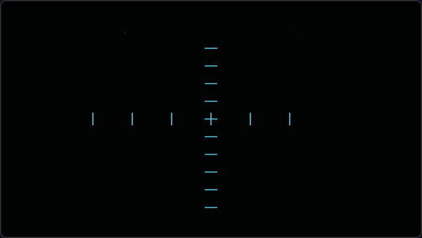

<div align="center">

# manim-web

**Manim in the browser. No Python.**

A TypeScript port of [3Blue1Brown's Manim](https://github.com/3b1b/manim) that
runs client-side, plus native modules for molecular and drug-binding, chemistry,
biology, and maps.


[](https://www.npmjs.com/package/manim-web)
[](https://github.com/maloyan/manim-web/actions/workflows/ci.yml)
[](https://codecov.io/gh/maloyan/manim-web)
[](LICENSE)

[Quick Start](#quick-start) · [Docs & Examples](https://maloyan.github.io/manim-web/) · [Parity](PARITY.md) · [Comparison](COMPARISON.md) · [npm](https://www.npmjs.com/package/manim-web)

</div>

---

## Why manim-web

Three open-source libraries expose the Manim API: ManimCE, ManimGL, and
manim-web. manim-web is the only one that runs client-side in the browser, and
the only one that ships chemistry, biology, molecular, and geographic modules.
Every claim below links to the module or document that proves it.

| Capability                   | What you get                                                                                                                 | Source                                              |
| ---------------------------- | ---------------------------------------------------------------------------------------------------------------------------- | --------------------------------------------------- |
| **Browser runtime**          | Import from a CDN module script and render in a `<canvas>`. No Python, no install.                                           | [Quick start](#quick-start)                         |
| **ManimCE API parity**       | 429 of 429 feasible ManimCE 0.22.0 public symbols ported (100% of the feasible surface).                                     | [PARITY.md](PARITY.md)                              |
| **Molecular / drug-binding** | 3D molecules from PDB, MOL/SDF, and SMILES; `Protein`, `BindingPocket`, docking, van der Waals / solvent / density surfaces. | [`src/mobjects/molecular/`](src/mobjects/molecular) |
| **Chemistry**                | Reaction arrows and schemes, electron-pushing arrows, Bohr diagrams, CPK colors.                                             | [`src/mobjects/chemistry/`](src/mobjects/chemistry) |
| **Biology**                  | `DNAHelix`, `Cell`, `AminoAcidChain`.                                                                                        | [`src/mobjects/biology/`](src/mobjects/biology)     |
| **Maps / geo**               | `Globe`, `ChoroplethMap`, `FlowArc`, map projections, GeoJSON and TopoJSON.                                                  | [`src/mobjects/geo/`](src/mobjects/geo)             |
| **Interactive player**       | A built-in player with play/pause, scrub, and segment navigation.                                                            | [`src/player/`](src/player)                         |
| **Export**                   | GIF and video (WebCodecs/MP4/WebM) straight from the browser.                                                                | [`src/export/`](src/export)                         |
| **Framework integrations**   | React, Vue, a web component, and a notebook entry point.                                                                     | [Framework integrations](#framework-integrations)   |

The chemistry, biology, molecular, and geo modules do not exist in the ManimCE
or ManimGL reference APIs. See [COMPARISON.md](COMPARISON.md) for the full,
source-backed comparison.

## Quick Start

### Browser (30 seconds, no install)

```html
<div id="container"></div>
<script type="module">
  import {
    Scene,
    Circle,
    Create,
  } from 'https://cdn.jsdelivr.net/npm/manim-web@latest/dist/manim-web.browser.js';

  const scene = new Scene(document.getElementById('container'), {
    width: 500,
    height: 300,
  });
  const circle = new Circle({ radius: 1.5 });
  await scene.play(new Create(circle));
</script>
```

### Locally

```bash
npm install manim-web
```

```typescript
import { Scene, Circle, Square, Create, Transform, FadeOut } from 'manim-web';

async function squareToCircle(scene: Scene) {
  const square = new Square({ sideLength: 3 });
  const circle = new Circle({ radius: 1.5 });

  await scene.play(new Create(square));
  await scene.play(new Transform(square, circle));
  await scene.play(new FadeOut(square));
}
```

See the [docs and examples](https://maloyan.github.io/manim-web/) for more, including a
[molecular and maps gallery](https://maloyan.github.io/manim-web/examples/molecular).

## What You Can Build

<table>
<tr>
<td align="center"><br><b>Function Graphs</b></td>
<td align="center"><br><b>LaTeX Equations</b></td>
</tr>
<tr>
<td align="center"><br><b>Text Animations</b></td>
<td align="center"><br><b>Geometry Transforms</b></td>
</tr>
</table>

## Features

- **Geometry** — Circle, Rectangle, Polygon, Arrow, Arc, Star, Brace, and more
- **Text & LaTeX** — Text, MathTex, Tex, Paragraph via KaTeX; Typst via an opt-in WASM compiler
- **Graphing** — Axes, NumberPlane, FunctionGraph, ParametricFunction, VectorField, BarChart
- **3D** — Sphere, Cube, Cylinder, Torus, Surface3D, ThreeDAxes with orbit controls
- **Animations** — FadeIn/Out, Create, Transform, Write, GrowFromCenter, AnimationGroup, LaggedStart
- **Interaction** — Draggable, Hoverable, Clickable mobjects, plus a scrub player
- **Export** — GIF and video (MP4/WebM via WebCodecs)
- **Science modules** — molecular/drug-binding, chemistry, biology, and maps (see [Why manim-web](#why-manim-web))
- **Graphs & Tables** — Network graphs, Matrix, Table

## Framework Integrations

### React

The `ManimScene` component builds the scene in the `onSceneReady` callback. It
runs once, after the scene mounts.

```tsx
import { ManimScene } from 'manim-web/react';
import { Circle, Create } from 'manim-web';

function App() {
  return (
    <ManimScene
      width={800}
      height={450}
      onSceneReady={async (scene) => {
        const circle = new Circle({ radius: 1.5 });
        await scene.play(new Create(circle));
      }}
    />
  );
}
```

### Vue

The `ManimScene` component emits a `ready` event with the scene instance. Build
the scene in the handler.

```vue
<script setup lang="ts">
import { ManimScene, Circle, Create, type Scene } from 'manim-web/vue';

const onReady = async (scene: Scene) => {
  const circle = new Circle({ radius: 1.5 });
  await scene.play(new Create(circle));
};
</script>

<template>
  <ManimScene :width="800" :height="450" @ready="onReady" />
</template>
```

A `manim-web/element` web component and a `manim-web/notebook` entry point are
also published.

## When to use ManimCE or ManimGL instead

manim-web is young and trades ecosystem size for a browser runtime. Reach for the
Python libraries when they fit better:

- **ManimCE** — the reference API, a mature ecosystem, far more tutorials and
  examples, and the full LaTeX package set (manim-web uses KaTeX, a large but
  incomplete LaTeX subset).
- **ManimGL** — native OpenGL rendering with the architectural edge on heavy
  scenes, plus 3Blue1Brown's own interactive playback window.

manim-web trails both on stars, age, and downloads. The exact numbers, with
sources, are in [COMPARISON.md](COMPARISON.md).

## Python to TypeScript

Have existing Manim scripts? Convert them:

```bash
node tools/py2ts.cjs input.py -o output.ts
```

## Logging

manim-web logs through a small structured logger. Subscribe to log messages
with `onLog` — useful for surfacing errors in your UI or forwarding them to a
server (handy for AI agents that write and debug scenes):

```ts
import { onLog } from 'manim-web';

const unsubscribe = onLog((entry) => {
  // entry = { level, message, timestamp } — always JSON-serializable
  fetch('/__log', { method: 'POST', body: JSON.stringify(entry) });
});

unsubscribe(); // stop receiving log messages
```

Forwarded messages are sanitized (tokens, keys, and emails are redacted) and
respect the `LOG_LEVEL` environment variable (`debug` | `info` | `warn` | `error`).

## Contributing

```bash
git clone https://github.com/maloyan/manim-web.git
cd manim-web
npm install
npm run dev
```

## How it was built

The port was written with coding agents. The story, with numbers from the git history: [Porting Manim to TypeScript with Coding Agents](https://maloyan.xyz/blog/porting-manim-to-typescript-with-agents).

## License

MIT. Created by [Narek Maloyan](https://maloyan.xyz).
